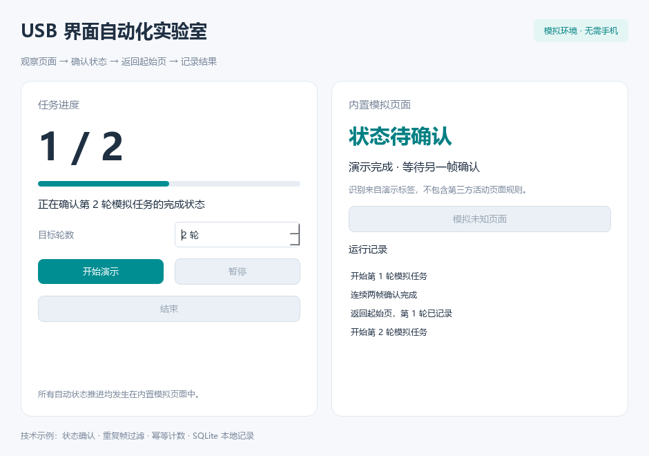

# 🧪 USB 界面自动化实验室

一个可以直接运行的 Python 技术示例，分享手机控件读取、局部页面识别、状态机和本地记录的实现方法。

**桌面演示使用内置模拟页面，无需连接手机。** 你可以观察一轮任务如何开始、确认完成、返回起始页，以及在未知页面出现时如何暂停。

<p align="center">
  
</p>

## ✨ 可以学到什么

| 模块 | 示例内容 |
| --- | --- |
| 页面识别 | 识别自建页面上的「开始演示」「处理中」「演示完成」标签 |
| 状态机 | 开始 → 处理中 → 两次确认完成 → 返回起始页 → 记录 |
| 观察校验 | 忽略重复或过期画面，连续两帧确认后才推进 |
| 本地记录 | 使用 SQLite 保存模拟任务与事件，重复写入不会重复计数 |
| USB 读取 | 通过 ADB / HDC 读取明确指定的获授权测试应用控件 |
| 可选 OCR | 独立脚本识别用户指定的本地图片 |

当前公开版提供通用技术演示，不包含第三方活动适配、自动领取权益或自动观看广告的流程。USB 读取脚本与桌面模拟流程相互独立，没有手机点击、滑动或启动应用的接口。

## 🚀 两种运行方式

### 使用 Windows 演示包

从 [Releases](https://github.com/OIIIIIC/qishui-music-assistant/releases) 获取标有 **Demo** 的 Windows 64 位 ZIP，完整解压后双击 `USBInterfaceLab.exe`。

请保留同目录的 `_internal` 文件夹。便携包包含桌面模拟演示和源码，无需安装 Python；USB 与 OCR 脚本需要按下方源码方式运行。

### 从源码运行

需要 Python 3.13，在项目目录打开 PowerShell：

```powershell
python -m venv .venv
.\.venv\Scripts\python.exe -m pip install -r requirements.txt
.\.venv\Scripts\python.exe main.py
```

## 👋 第一次体验

1. 设置 1～2 轮，点击「开始演示」。
2. 观察右侧模拟页面的变化和左侧进度。
3. 点击「暂停 / 继续」，查看任务如何停下和恢复。
4. 点击「模拟未知页面」，体验识别失败后的暂停处理。

所有数据都来自自建模拟页面。运行记录保存在 `%LOCALAPPDATA%\USBInterfaceLab\`，不会读取其他应用的个人记录。

## 🔌 读取自己的测试应用

只读脚本需要你明确指定调试工具、设备序列号及获授权测试应用的包名：

```powershell
.\.venv\Scripts\python.exe tools/inspect_device.py --platform android --tool "C:\Android\platform-tools\adb.exe" --serial "TEST_DEVICE" --package "com.example.mytestapp"
```

上面的路径、序列号和包名都是占位示例，请替换为自己的测试环境。鸿蒙可以使用 `--platform harmony` 并指定 `hdc.exe`。

Android 示例读取控件布局与截图，鸿蒙示例读取控件布局。解析与指令约束有模拟测试，当前通用版本尚未完成手机真机验证。

采集结果默认保存在 `.local/usb-observation/`，不会上传。截图可能包含屏幕上的个人信息，分享前请检查。

## 🔍 可选本地 OCR

```powershell
.\.venv\Scripts\python.exe -m pip install -r requirements-ocr.txt
.\.venv\Scripts\python.exe tools/ocr_image.py "your-test-image.png"
```

OCR 只读取指定图片，不连接手机。为保持演示包精简，OCR 运行库和模型不随桌面 ZIP 分发。

## 🛠️ 开发与构建

```powershell
.\.venv\Scripts\python.exe -m pip install -r requirements-dev.txt
.\.venv\Scripts\python.exe -m pytest -q
powershell -ExecutionPolicy Bypass -File build.ps1
.\.venv\Scripts\python.exe tools/package_release.py
```

更多说明见 [开发文档](docs/development.md)。欢迎反馈演示程序、通用读取及状态机的问题。

## 📄 使用边界与许可证

源码采用 [MIT License](LICENSE)，第三方组件遵循各自许可证。源码许可不代表任何第三方平台的授权。

设备与应用的测试应获得相应授权，并遵守平台协议。项目不承诺任何第三方平台的使用许可，也不提供规避风控或批量获取活动权益的支持。
