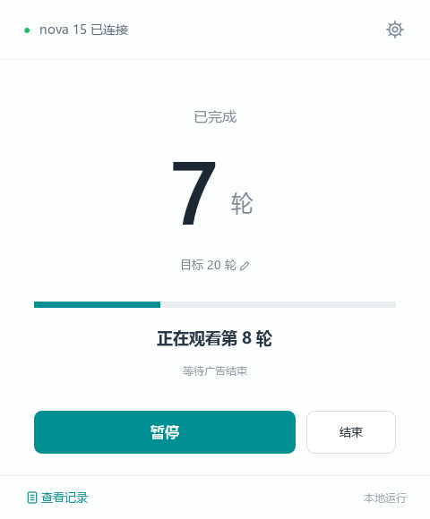
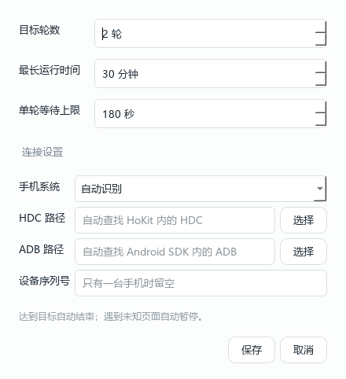

# 🎵 汽水音乐助手

一个简洁的 Windows 桌面小工具：通过 USB 连接手机，帮助完成汽水音乐「看广告领取畅听」的重复操作。

设置好目标轮数，点击开始，就能查看进度、暂停任务和检查记录。界面识别在电脑本地完成，无需填写大模型 API Key。

<p align="center">
  
</p>
<p align="center">主界面预览 · 图中的设备与进度为演示数据</p>

## ✨ 能做什么

- **自动走完一轮**：进入广告 → 等待完成 → 关闭广告 → 返回领取面板。
- **清楚显示进度**：达到目标自动结束，观看轮数与听歌天数分别记录。
- **随时暂停和结束**：遇到未知页面、设备断开或等待超时，会暂停任务。
- **本地识别与记录**：使用手机控件信息、OCR 和图标匹配，不调用云端识别接口。
- **USB 连接手机**：鸿蒙使用 HDC，Android 使用 ADB。无需打开投屏窗口，不占用电脑鼠标。

## 📱 支持情况

| 平台 | 当前状态 |
| --- | --- |
| Windows 64 位电脑 | 提供源码及便携版构建脚本；已有 Windows 11 验证记录 |
| 鸿蒙手机 | 已在 nova 15 / HarmonyOS 7.0 / 汽水音乐 21.1.1 上验证限定轮数流程 |
| Android 手机 | **试验支持**：已通过本地模拟测试，尚未进行 Android 真机验证 |

目前适配带有「立即解锁 第 N 天畅听」或「解锁第 N 天畅听」按钮的免费听歌领取面板。其他活动入口和广告样式可能需要进一步适配。

## 🚀 第一次使用

### 1. 准备电脑和手机

- 使用 Windows 64 位电脑和 USB 数据线。
- 鸿蒙：准备 HoKit 自带的 HDC，或自行安装鸿蒙 HDC 工具。
- Android：准备 Android SDK Platform-Tools 中的 ADB，也可使用 scrcpy 附带的 `adb.exe`。
- 开启手机的开发者选项与 USB 调试，连接电脑后，在手机上允许调试。

### 2. 打开助手

如果你拿到的是 Windows 便携 ZIP，先**完整解压**，再双击 `汽水音乐助手.exe`。请保留旁边的 `_internal` 文件夹；便携版无需安装 Python。

如果你下载的是本仓库源码，请按下方「从源码运行」启动。

### 3. 设置并开始

1. 手机保持解锁、亮屏，打开汽水音乐免费听歌领取面板。
2. 点击助手中的目标轮数，建议第一次先尝试 **1～2 轮**。
3. 点击「开始」，保持汽水音乐在手机前台，等待任务完成。

<p align="center">
  
</p>

找不到手机时，点击右上角齿轮 →「连接设置」，选择手机系统，并指定 `hdc.exe` 或 `adb.exe`。只有一台手机时，设备序列号可以留空；多台手机时需要明确指定。

| 按钮 | 作用 |
| --- | --- |
| 开始 / 继续 | 创建任务，或重新检查当前页面后继续 |
| 暂停 | 停止后续自动操作；手机上的广告可能继续播放 |
| 结束 | 保存记录，不再开启下一轮 |
| 查看记录 | 查看最近事件，并打开本地数据文件夹 |

## 💡 常见问题

**看完一轮，就多一天畅听吗？**

不一定，活动可能要求看多个广告才增加一天。助手确认广告完成并返回领取面板后才计为一轮；新增听歌天数单独核对。

**为什么突然暂停了？**

先检查手机是否锁屏、断开连接，或出现了新的广告、活动页面。助手遇到无法确认的页面会暂停，处理好后再点击继续。

**需要联网或 API Key 吗？**

电脑上的识别不需要大模型或云端接口，手机加载广告仍然需要网络。

**为什么分享包比源码大很多？**

便携版包含 Python 运行环境、Qt 界面库和本地 OCR 模型。分享时发送完整便携 ZIP 即可，无需发送 `.venv`、`build` 或整个开发目录。

**记录保存在哪里？**

默认保存在 `%LOCALAPPDATA%\QishuiAssistant\`，包括设置、任务记录和异常截图。重开程序会展示最近任务的已完成轮数，中断时未确认的轮次不会自动补记成功。

运行时保持电脑开机、不休眠，避免同时手动操作手机。助手暂不自动处理锁屏、授权弹窗、验证码、购买或下载页面。

## 🛠️ 从源码运行

需要 Python 3.13。在项目目录打开 PowerShell：

```powershell
python -m venv .venv
.\.venv\Scripts\python.exe -m pip install -r requirements.txt
.\.venv\Scripts\python.exe main.py
```

使用独立虚拟环境即可，无需激活脚本。使用 `uv` 的安装方法见 [开发说明](docs/development.md)。

### 构建 Windows 便携版

```powershell
powershell -ExecutionPolicy Bypass -File build.ps1
```

输出位于 `dist/汽水音乐助手/`，请将整个输出目录一起分发，不能只复制 `.exe`。

## 🤝 一起完善

欢迎反馈新的页面样式、连接问题，或提交改进。反馈时请说明手机系统、汽水音乐版本、操作步骤和实际现象，分享截图前请遮住个人信息。

开发诊断、测试与项目结构见 [开发说明](docs/development.md)，历史真机验证范围见 [验证记录](docs/verification.md)。

## 📄 许可证

本项目源码采用 [MIT License](LICENSE)。第三方运行库和 OCR 模型遵循各自的许可证，分享包会收集安装发行版自带的第三方声明。

这是一个独立的个人项目，与汽水音乐官方无关联。
